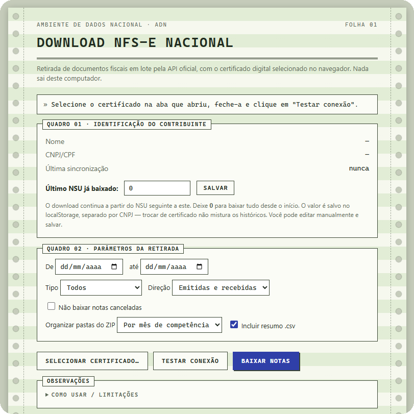

# Download NFS-e Nacional (em lote)

"Algo tão simples não deveria ser difícil, muito menos cobrado."

<p align="center">
  
</p>

Baixe os XMLs das suas NFS-e (emitidas e recebidas) direto da **API oficial do ADN** (`adn.nfse.gov.br`), usando seu certificado digital. Sem captcha, sem instalar programa, sem enviar dados a terceiros.

## Como usar

1. Baixe o código: **[clique aqui para baixar o ZIP](https://github.com/iurijw/download-nfse-nacional/archive/refs/heads/main.zip)** (ou botão verde **Code → Download ZIP**).
2. Extraia o ZIP em qualquer pasta.
3. Dê **duplo clique em `NFSe Downloader.bat`**.
4. Na página que abrir, clique em **"Selecionar certificado…"**, escolha seu certificado na janela do Chrome e feche a aba que abriu.
5. Clique em **"Testar conexão"** e depois em **"Buscar todas as notas"**. A busca varre o feed inteiro, sempre a partir do NSU `0`.
6. Todas as notas aparecem **listadas na própria página** (Quadro 04). Use os filtros do Quadro 02 (período, tipo, direção, canceladas, busca por texto) e/ou desmarque linhas individuais.
7. Clique em **"Baixar ZIP dos marcados"**. O ZIP leva exatamente o que está listado e marcado, com os XMLs organizados em pastas, o **DANFSe de cada nota em PDF** e um resumo `.csv`.

Os filtros são aplicados **na listagem**, não na consulta: mudar um filtro não refaz nenhuma chamada à API. Dá para gerar vários ZIPs diferentes (um por mês, um por tomador, só as recebidas...) a partir da mesma busca.

Na listagem dá para **ordenar clicando no cabeçalho** de qualquer coluna. Notas canceladas aparecem em vermelho, com a situação `CANCELADA`. Notas em que o valor bruto (`vBC`) difere do líquido (`vLiq`) — ou seja, com **imposto retido** — aparecem com a linha em amarelo e a etiqueta `VALORES RETIDOS`; passe o mouse na etiqueta para ver bruto, líquido e diferença, ou digite `retido` na busca para listar só elas.

## O que vem no ZIP

Cada nota gera dois arquivos com o mesmo nome, lado a lado:

```
NFSe/2026-07/20260710_NFSe-1201_ACME_SERVICOS_LTDA-para-PREFEITURA_MUNICIPAL_R2713.xml
NFSe/2026-07/20260710_NFSe-1201_ACME_SERVICOS_LTDA-para-PREFEITURA_MUNICIPAL_R2713.pdf
```

O PDF é o **DANFSe v2.0**, no leiaute da NT 008/2026 — com QR code de consulta, blocos de prestador/tomador/destinatário/intermediário, tributação municipal, federal e IBS/CBS, e marca d'água nas canceladas. Ele é desenhado pela própria página, a partir do XML: a API do governo que devolvia o PDF pronto (`GET /danfse/{chave}`) foi **desligada em 03/08/2026**, e desde então cabe a cada sistema gerar o documento. O arquivo com valor fiscal continua sendo o XML.

Dá para desmarcar **"Incluir DANFSe em PDF"** se quiser só os XMLs — o ZIP fica bem menor e mais rápido.

## O que cada arquivo faz

| Arquivo | Função |
|---|---|
| `NFSe Downloader.bat` | Abre o Chrome/Edge em um **perfil separado** com a checagem de origem (CORS) desativada — sem isso, o navegador bloqueia a leitura das respostas da API do governo. Não altera nada no seu Chrome normal. |
| `nfse-downloader.html` | A aplicação inteira, em um único arquivo. Consulta a API oficial (`GET /contribuintes/DFe/{nsu}?lote=true`) do NSU 0 até o fim do feed, descompacta os XMLs, detecta a empresa do certificado, lista tudo na tela, desenha o DANFSe em PDF e monta o ZIP do que você filtrou — tudo localmente, no seu navegador. |

## Segurança e código aberto

- **Todo o código está neste repositório**, em um único HTML legível, sem bibliotecas externas nem CDN. Qualquer pessoa pode auditar.
- O gerador do DANFSe é um **port em JavaScript do leiaute do [BrazilFiscalReport](https://github.com/Engenere/BrazilFiscalReport)** (Engenere), licenciado sob **LGPL-3.0**; no HTML ele fica entre os marcadores `__DANFSE_INICIO__` e `__DANFSE_FIM__` e mantém essa licença. O PDF, o QR code e a tabela de municípios do IBGE são produzidos sem nenhuma dependência externa — por isso o arquivo tem ~250 KB.
- A página se comunica **apenas com `adn.nfse.gov.br`** (servidor do governo). Nenhum dado seu sai do seu computador.
- **O certificado digital nunca é acessado pelo código**: quem o apresenta é o próprio Chrome/Windows, na conexão segura (mTLS). A página não consegue ler nem exportar o certificado.
- Sem conta, sem telemetria, sem limite de downloads.

## Requisitos

- Windows com Chrome ou Edge instalado.
- Certificado digital (e-CNPJ ou e-CPF): A1 instalado no Windows ou A3 no token/cartão.

## Avisos

- Use a janela aberta pelo `.bat` **somente para esta ferramenta** (a proteção de origem fica desativada nesse perfil dedicado).
- Para trocar de certificado/empresa, feche **todas** as janelas desse perfil dedicado e abra o `.bat` de novo.
- Como a busca sempre percorre o feed inteiro, caixas grandes levam alguns minutos (a API é consultada em lotes, com pausa de 1s entre eles). Dá para clicar em **"Parar"** a qualquer momento: o que já veio fica listado e pode ser baixado normalmente.
- Notas canceladas são eventos separados no feed. Como o histórico completo é lido a cada busca, todo cancelamento existente é reconhecido e a nota correspondente é marcada como `CANCELADA` na listagem — e sai com a marca d'água no DANFSe.
- O DANFSe é gerado só para NFS-e; eventos e DPS entram no ZIP apenas como XML. Se algum XML vier fora do leiaute nacional, o PDF daquela nota é pulado e o aviso aparece no Quadro 03 — o XML entra no ZIP do mesmo jeito.
