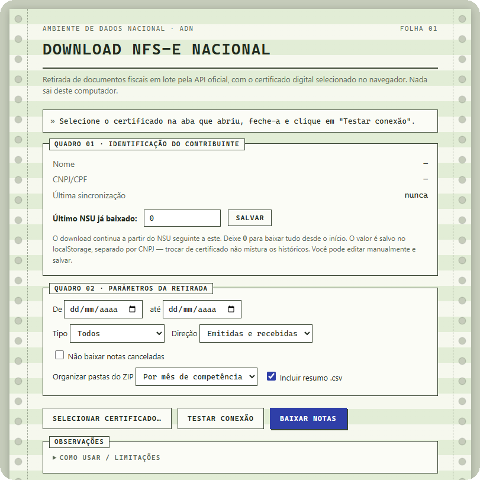

# Download NFS-e Nacional (em lote)

"Algo tão simples não deveria ser difícil, muito menos cobrado."

<p align="center">
  
</p>

Baixe os XMLs das suas NFS-e (emitidas e recebidas) direto da **API oficial do ADN** (`adn.nfse.gov.br`), usando seu certificado digital. Sem captcha, sem instalar programa, sem enviar dados a terceiros.

## Como usar

1. Baixe o código: **[clique aqui para baixar o ZIP](https://github.com/iurijw/download-nfse-nacional/archive/refs/heads/main.zip)** (ou botão verde **Code → Download ZIP**).
2. Extraia o ZIP em qualquer pasta.
3. Dê **duplo clique em `NFSe Downloader.bat`**.
4. Assim que a página abre, o Chrome **pede o certificado**: escolha o seu (no A3, digite o PIN). A página avisa "Certificado conectado".
5. Digite o **CNPJ a consultar** no Quadro 01: o da empresa do certificado (ou de uma filial dela) ou o de uma empresa que deu **procuração** ao certificado. Ele fica guardado no navegador para as próximas vezes.
6. Clique em **"Buscar notas"**. A busca vai do NSU inicial até o fim do feed. Se o ADN recusar (sem procuração, certificado não aceito, ADN fora do ar), o motivo aparece num aviso no topo da página.
7. Todas as notas aparecem **listadas na própria página** (Quadro 04). Use os filtros do Quadro 02 (período de processamento, tipo, direção, canceladas, busca por texto) e/ou desmarque linhas individuais.
8. Clique em **"Baixar ZIP dos marcados"**. O ZIP leva exatamente o que está listado e marcado, com os XMLs organizados em pastas, o **DANFSe de cada nota em PDF** e um resumo `.csv`.

Os filtros são aplicados **na listagem**, não na consulta: mudar um filtro não refaz nenhuma chamada à API. Dá para gerar vários ZIPs diferentes (um por mês, um por tomador, só as recebidas...) a partir da mesma busca.

Na listagem dá para **ordenar clicando no cabeçalho** de qualquer coluna. Notas canceladas aparecem em vermelho, com a situação `CANCELADA`. Notas com **imposto retido** aparecem com a linha em amarelo e a etiqueta `VALORES RETIDOS`. Isso vale para qualquer tributo retido informado no XML (`vRetIRRF`, `vRetCP`, `vRetCSLL`, PIS/COFINS retidos, ISSQN retido ou `vTotalRet`), **mesmo quando o valor bruto (`vBC`) é igual ao líquido (`vLiq`)**, e também para notas em que o bruto difere do líquido. Passe o mouse na etiqueta para ver cada tributo retido, bruto, líquido e diferença, ou digite `retido` (ou o tributo, como `irrf`) na busca para listar só elas. O `.csv` traz a coluna `Tributos retidos` com o detalhe de cada nota.

O filtro de período usa a **data de processamento** da nota (`dhProc`), não a de emissão (`dhEmi`) — uma DPS emitida em 30/06 e processada em 01/07 entra em julho. DPS ainda não processada (sem `dhProc`) é filtrada pela emissão. Quando as duas datas caem em dias diferentes, a listagem mostra um aviso no topo, destaca as duas datas e põe a etiqueta `DATAS DIFERENTES` na linha; passe o mouse nela para ver data e hora de cada uma, ou digite `datas diferentes` na busca para listar só essas notas. O resumo `.csv` traz as colunas `Processamento` e `Datas diferentes`.

## CNPJ a consultar e procuração (mudança do ADN em 03/11/2026)

Desde 03/11/2026 o ADN recusa a consulta `GET /contribuintes/DFe/{nsu}` que não diz de quem são as notas: sem o parâmetro `cnpjConsulta`, a resposta é `400` com `StatusProcessamento: REJEICAO`, a lista `Erros` vazia e `TipoConsulta: InscricaoCertificado`. Por isso o CNPJ é digitado no campo **CNPJ a consultar** e vai em toda consulta (`?lote=true&cnpjConsulta=…`; um CPF vai em `cpfConsulta`).

Quem decide se o certificado pode consultar aquele CNPJ é o ADN:

| CNPJ digitado | O que o ADN faz |
|---|---|
| Da empresa do certificado, ou de uma filial dela (mesma raiz) | Consulta pela raiz do certificado (`TipoConsulta: CnpjBase`), como antes. |
| De outra empresa que deu procuração ao certificado | O ADN confere a procuração e devolve as notas dela. |
| De outra empresa, sem procuração | Recusa com `E2245`: "Não há procuração da inscrição <certificado> para a inscrição <consultada>". |

Quando o ADN recusa, a página mostra um aviso com o motivo. No `E2245`, o aviso mostra as duas inscrições: a do certificado escolhido e a consultada. A procuração tem que ter sido dada **exatamente para a inscrição do certificado**: se o certificado é o e-CNPJ do escritório, para o CNPJ do escritório; se é o e-CPF do contador, para o CPF dele. Também precisa incluir o serviço da NFS-e. A página não tem como criar nem conferir a procuração: só repassa o que o ADN responde.

Outros avisos: recusa sem código de erro, certificado não aceito (HTTP 401/403), ADN indisponível (HTTP 429/5xx) e falta de conexão (CORS ou certificado não apresentado).

- O dígito verificador é conferido antes de consultar, inclusive no CNPJ alfanumérico.
- Cada CNPJ consultado guarda o seu próprio último NSU neste navegador. Trocar o CNPJ tira da tela a listagem do anterior.
- Quem já usava a página volta com o último CNPJ consultado já preenchido.

## Interface simples

No topo da página há o seletor **Interface**: `Clássica` (a folha de formulário contínuo) ou `Simples` (visual sóbrio, sem enfeites). É só aparência: as funções, os filtros e o ZIP são os mesmos. A escolha fica salva no perfil do navegador aberto pelo `.bat`.

## O que vem no ZIP

Cada nota gera dois arquivos com o mesmo nome, lado a lado:

```
NFSe/2026-07/20260710_NFSe-1201_ACME_SERVICOS_LTDA-para-PREFEITURA_MUNICIPAL_R2713.xml
NFSe/2026-07/20260710_NFSe-1201_ACME_SERVICOS_LTDA-para-PREFEITURA_MUNICIPAL_R2713.pdf
```

O PDF é o **DANFSe v2.0**, no leiaute da NT 008/2026 — com QR code de consulta, blocos de prestador/tomador/destinatário/intermediário, tributação municipal, federal e IBS/CBS, e marca d'água nas canceladas. Ele é desenhado pela própria página, a partir do XML: a API do governo que devolvia o PDF pronto (`GET /danfse/{chave}`) foi **desligada em 03/08/2026**, e desde então cabe a cada sistema gerar o documento. O arquivo com valor fiscal continua sendo o XML.

Dá para desmarcar **"Incluir DANFSe em PDF"** se quiser só os XMLs — o ZIP fica bem menor e mais rápido.

## O que cada arquivo faz

| Arquivo | Função |
|---|---|
| `NFSe Downloader.bat` | Abre o Chrome/Edge em um **perfil separado** com a checagem de origem (CORS) desativada — sem isso, o navegador bloqueia a leitura das respostas da API do governo. Não altera nada no seu Chrome normal. |
| `nfse-downloader.html` | A aplicação inteira, em um único arquivo. Consulta a API oficial (`GET /contribuintes/DFe/{nsu}?lote=true&cnpjConsulta={CNPJ}`) do NSU inicial até o fim do feed, descompacta os XMLs, lista tudo na tela, desenha o DANFSe em PDF e monta o ZIP do que você filtrou — tudo localmente, no seu navegador. |

## Segurança e código aberto

- **Todo o código está neste repositório**, em um único HTML legível, sem bibliotecas externas nem CDN. Qualquer pessoa pode auditar.
- O gerador do DANFSe é um **port em JavaScript do leiaute do [BrazilFiscalReport](https://github.com/Engenere/BrazilFiscalReport)** (Engenere), licenciado sob **LGPL-3.0**; no HTML ele fica entre os marcadores `__DANFSE_INICIO__` e `__DANFSE_FIM__` e mantém essa licença. O PDF, o QR code e a tabela de municípios do IBGE são produzidos sem nenhuma dependência externa — por isso o arquivo tem ~250 KB.
- A página se comunica **apenas com `adn.nfse.gov.br`** (servidor do governo). Nenhum dado seu sai do seu computador.
- **O certificado digital nunca é acessado pelo código**: quem o apresenta é o próprio Chrome/Windows, na conexão segura (mTLS). A página não consegue ler nem exportar o certificado.
- Sem conta, sem telemetria, sem limite de downloads.

## Requisitos

- Windows com Chrome ou Edge instalado.
- Certificado digital (e-CNPJ ou e-CPF): A1 instalado no Windows ou A3 no token/cartão.

## Avisos

- Use a janela aberta pelo `.bat` **somente para esta ferramenta** (a proteção de origem fica desativada nesse perfil dedicado).
- Para trocar de **certificado**, feche **todas** as janelas desse perfil dedicado e abra o `.bat` de novo (o Chrome memoriza o certificado escolhido até ser fechado). Para trocar só o **CNPJ consultado** (outra filial, outra empresa com procuração), basta digitar o novo CNPJ.
- Como a busca sempre percorre o feed inteiro, caixas grandes levam alguns minutos (a API é consultada em lotes, com pausa de 1s entre eles). Dá para clicar em **"Parar"** a qualquer momento: o que já veio fica listado e pode ser baixado normalmente.
- Notas canceladas são eventos separados no feed. Como o histórico completo é lido a cada busca, todo cancelamento existente é reconhecido e a nota correspondente é marcada como `CANCELADA` na listagem — e sai com a marca d'água no DANFSe.
- O DANFSe é gerado só para NFS-e; eventos e DPS entram no ZIP apenas como XML. Se algum XML vier fora do leiaute nacional, o PDF daquela nota é pulado e o aviso aparece no Quadro 03 — o XML entra no ZIP do mesmo jeito.
